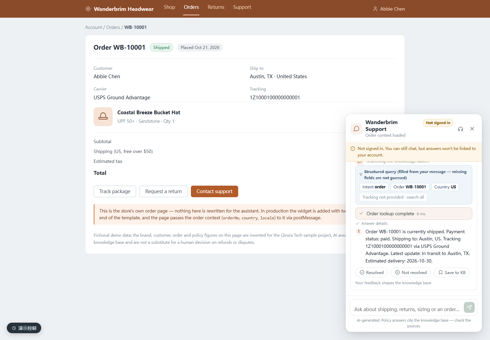
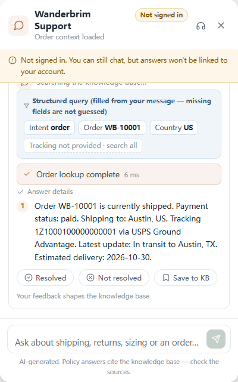
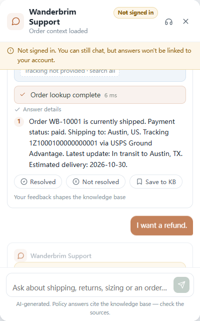
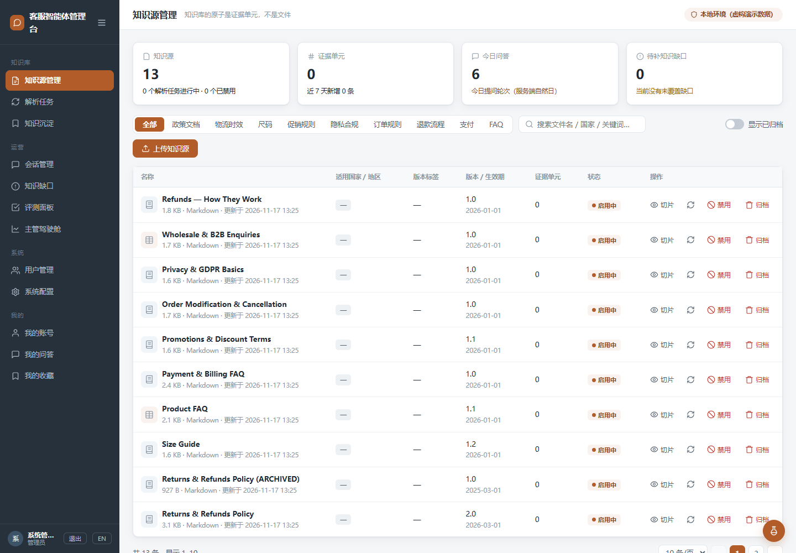
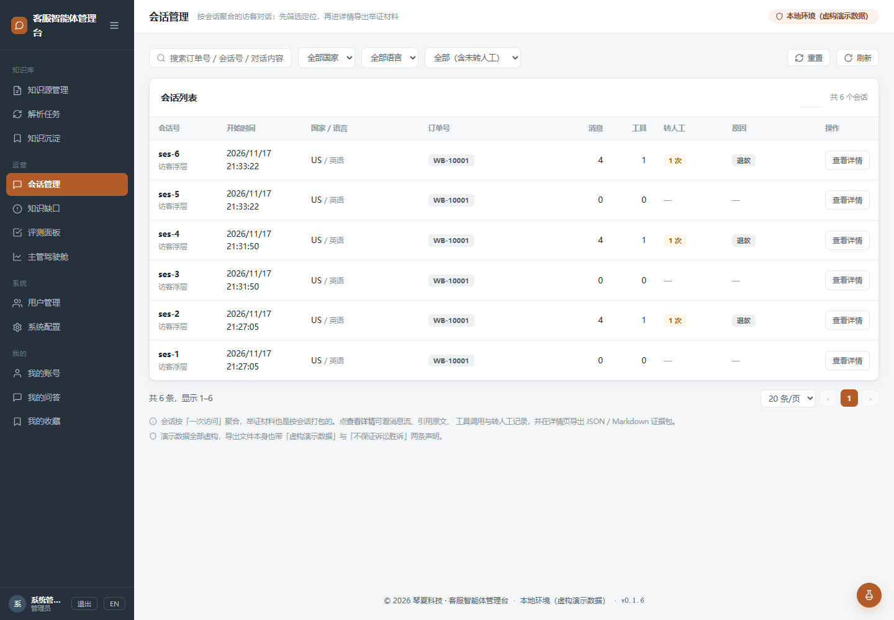
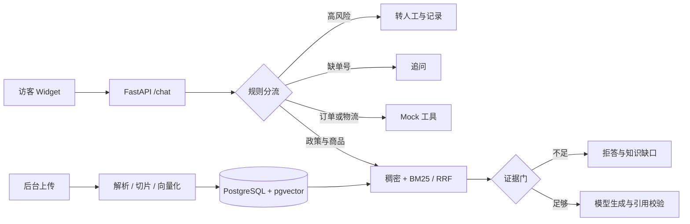

# 陌阡跨境电商客服助手

[](https://github.com/zhaoxuejie/moqian-cbecom-assistant/actions/workflows/ci.yml)
[](LICENSE)
[](pyproject.toml)
[](docker-compose.yml)

**政策查知识库，订单查工具，风险交给人工。**

`moqian-cbecom-assistant` 是面向跨境独立站的开源客服智能体：把配送、退换货、尺码等资料变成
可追溯的 RAG 答案，通过工具查询订单与物流，并在退款诉求、投诉、法务、账户安全场景转人工。
支持自行部署、学习和二次开发。

<p align="center">
  <a href="screenshots/widget-overview.png"></a>
</p>

<p align="center"><sub>真实运行界面 · Wanderbrim 虚构演示数据 · 订单与物流使用 mock 工具</sub></p>

自带 **13 份英文虚构语料 · 15 条 mock 订单 · 90 条分层评测用例**，使用 Apache-2.0 协议。
本项目提供演示与开发基础，接入真实商店需要另行实现业务 API、身份校验与订单访问授权。

## 目录

- [核心能力](#features)
- [界面展示](#screens)
- [快速开始](#start)
- [配置说明](#config)
- [Widget 接入](#integration)
- [架构与目录](#architecture)
- [评测与开发](#evaluation)
- [能力边界与常见问题](#faq)
- [贡献与许可](#contributing)

<a id="features"></a>

## 核心能力

| 能力 | 行为 |
|---|---|
| 政策与商品问答 | 稠密向量 + BM25 检索、RRF 融合、证据门、服务端引用校验；证据不足时拒答 |
| 订单与物流 | 通过 `query_order` / `query_logistics` 查询 mock 数据；缺单号先追问，失败时明确降级 |
| 风险转人工 | 识别退款诉求、投诉、法务与账户安全；普通退货政策咨询仍可查知识库 |
| 多语言 | 支持英语、西班牙语、法语、德语问答；后台支持中英文切换，翻译覆盖仍在完善 |
| 知识管理 | 文档上传、解析、切片、向量化、版本与有效期过滤、原文预览及知识缺口管理 |
| 会话与证据 | SSE 问答、引用查看、会话回放、工具记录、转人工记录、JSON / Markdown 证据导出 |
| 评测与治理 | 在线问答共用管线、分层用例、问答日志、用户和系统配置 |

所有品牌、客户、订单、物流及政策数据均为虚构，不代表真实商家、平台政策或法律意见。
转人工表示提供转接信息与记录，不会自动接通外部客服平台。

<a id="screens"></a>

## 界面展示

点击图片可查看原图。以下均由本项目本地运行生成，未使用真实客户数据。

| 访客客服 | 人工接管 |
|:---:|:---:|
| [](screenshots/widget-order.png) | [](screenshots/widget-handoff.png) |
| mock 工具提供订单事实 | 高风险诉求交由人工处理 |

| 知识管理 | 会话管理 |
|:---:|:---:|
| [](screenshots/admin-knowledge.png) | [](screenshots/admin-conversations.png) |
| 虚构语料建档与状态 | 查看会话、转人工与工具记录 |

<a id="start"></a>

## 快速开始

### 1. 准备环境与模型

需要 Docker Desktop / Docker Engine + Compose，以及一个 OpenAI 兼容的 LLM 端点。
政策问答和语料解析还需要 embedding 服务，默认使用 Ollama 的 **1024 维 `bge-m3`**：

```bash
ollama pull bge-m3
```

Ollama 应处于运行状态。也可使用兼容 OpenAI 的 embedding API，配置方法见下方。
数据库向量列固定为 1024 维，更换维度需同步迁移并重新向量化，不能只改环境变量。

### 2. 配置

克隆本仓库，在项目根目录执行：

```bash
git clone https://github.com/zhaoxuejie/moqian-cbecom-assistant.git
cd moqian-cbecom-assistant
cp .env.example .env
```

Windows PowerShell 使用 `Copy-Item .env.example .env`。编辑 `.env`：

| 变量 | 要求 |
|---|---|
| `LLM_BASE_URL` / `LLM_MODEL` / `LLM_API_KEY` | 按模型服务商填写，示例值需要替换 |
| `ADMIN_INITIAL_PASSWORD` | 设置初始管理员口令；留空不会创建管理员 |
| `JWT_SECRET` | 替换为随机长串，禁止公网使用示例值 |
| `POSTGRES_PASSWORD` | 使用自己的数据库口令；本机直连的 `DATABASE_URL` 同步修改 |

可用 `python -c "import secrets; print(secrets.token_urlsafe(48))"` 生成 JWT 密钥。
不要把 `.env` 提交或分享给他人。

### 3. 启动服务

```bash
docker compose up -d --build
docker compose ps
```

首次启动自动执行数据库迁移、写入 15 条 mock 订单，并按配置创建管理员。
本项目使用独立容器与数据卷，本地入口为：

| 入口 | 地址 |
|---|---|
| 访客演示页 | <http://localhost:8002/widget-app/> |
| 管理后台 | <http://localhost:8002/admin-app/> |
| 健康检查 | <http://localhost:8002/health> |
| API 文档 | <http://localhost:8002/docs> |

后台账号默认为 `admin`，密码为你设置的 `ADMIN_INITIAL_PASSWORD`。
本地 Compose 仅监听回环地址，数据库直连端口为 `5435`。公网发布方法与安全要求见
[SECURITY.md](SECURITY.md)。

### 4. 导入知识语料

语料通过 `data/` 挂载进入容器。Bash：

```bash
mkdir -p data/inbox
cp samples/demo-corpus/*.md data/inbox/
docker compose exec app python -m app.import_docs --root data/inbox --parse-now --no-enqueue
```

PowerShell：

```powershell
New-Item -ItemType Directory -Force data/inbox | Out-Null
Copy-Item samples/demo-corpus/*.md data/inbox/
docker compose exec app python -m app.import_docs --root data/inbox --parse-now --no-enqueue
```

README 会自动跳过，13 份业务文档被建档；其中包含用于过滤验证的旧版退货政策。
`--parse-now --no-enqueue` 在当前进程同步解析，避免同时排队给 worker。
若日志出现解析失败，先检查 embedding 服务与维度，修复后在同一命令末尾加 `--reparse` 重试。
不要只凭进程退出码判断入库成功，应在后台确认文档状态、切片与任务日志。

### 5. 试问

- `How long is the US return window?`：政策检索与引用。
- `Where is my order WB-10001?`：查询虚构订单与物流。
- `I want a refund.`：退款诉求转人工。
- `¿Cuánto dura el plazo de devolución en España?`：西班牙语政策问答。

不配置真实模型也可启动和浏览界面；mock 工具与规则转人工不调用 LLM，政策问答需要完成模型配置和语料入库。

<a id="config"></a>

## 配置说明

完整变量见 [.env.example](.env.example)。后台可保存部分运行时配置，修改环境变量后也应核对后台的配置覆盖值。

| 配置 | 说明 |
|---|---|
| `LLM_*` | OpenAI 兼容回答服务、模型、令牌预算与超时 |
| `EMBEDDING_*` | embedding 服务；当前数据库要求 1024 维 |
| `EMBEDDING_BASE_URL_DOCKER` | Compose 内访问 embedding 的地址，默认 `http://host.docker.internal:11434/v1` |
| `RETRIEVAL_*` / `EVIDENCE_*` | 召回、融合与证据门阈值 |
| `RERANKER_PROVIDER` | 默认 `none`；接入重排服务时再配置 |
| `HANDOFF_*` / `SUPPORTED_LOCALES` | 人工支持联系方式、工作时间、支持语言 |
| `DEMO_ENABLED` / `DEMO_FAULT_ENABLED` | 演示入口配额与故障注入，默认关闭 |

使用远程 embedding 时，同时设置本地的 `EMBEDDING_BASE_URL` 和容器的
`EMBEDDING_BASE_URL_DOCKER`，并按服务要求提供 `EMBEDDING_API_KEY`。
服务启停使用 `docker compose stop` / `docker compose up -d`；修改源码后重建 app 与 worker。
知识库数据存于本地 `data/`，数据库存于 `cbecom_pgdata` 卷。

<a id="integration"></a>

## Widget 接入

推荐通过反向代理把助手路由部署在商店**同源**地址，再在页面末尾加入：

```html
<script src="/widget-app/loader.js" data-server="" data-position="right"></script>
<script>
  window.MoqianWidget.setContext({
    orderNo: 'WB-10001',
    country: 'US',
    locale: 'en'
  });
</script>
```

通过 `window.MoqianWidget.open()` / `close()` 控制面板。
浮层使用 iframe 隔离样式，通过 postMessage 接收上下文。
默认未配置跨域 CORS，不能只把脚本地址换成其他域名就当作接入完成。

**上下文不是授权凭证。** 真实订单工具必须在服务端验证商店、访客身份与订单归属，
再返回经裁剪的字段；不要信任前端传入的订单号或客服身份声明。
工具接口与当前 mock 实现见 [modules/tools/](modules/tools/)。

<a id="architecture"></a>

## 架构与目录



```text
moqian-cbecom-assistant/
├── app/               业务装配：API、RAG、意图、工具编排、转人工、品牌配置
├── modules/           通用机制：模型、检索、证据、引用、解析、任务、身份、工具
├── frontend/          零构建前端：管理后台与访客 Widget
├── contracts/         OpenAPI 契约与说明
├── migrations/        有序 SQL 迁移（含虚构订单种子）
├── samples/           13 份英文虚构业务语料
├── evals/             90 条评测用例、运行器与历史参考报告
├── tests/             单元、接口、契约与数据库测试
├── scripts/           自检、演示码、翻译审计与本地重置工具
├── screenshots/       本项目运行截图
├── .github/           CI、Issue 和 PR 模板
├── .env.example       无真实凭证的配置示例
└── docker-compose.yml 本地 app、worker、pgvector 编排
```

依赖方向为 `app → modules`，公共模块之间互不 import。
业务词汇和配置由 `app/` 注入；前端展示、控制器与接口适配分层。
目录使用说明见 [frontend/README.md](frontend/README.md)、[scripts/README.md](scripts/README.md)。

<a id="evaluation"></a>

## 评测与开发

90 条用例覆盖：政策 30、工具 25、硬转人工 15、缺口拒答 10、多语言 10。
线上与评测共用 `app/rag_runner.py`，评测方法见 [evals/README.md](evals/README.md)。

```bash
# 只校验用例，不调用模型
python -m evals.runner --dry-run
# 已在本地开发环境安装项目并配置数据库、模型、语料后，再进行真实评测
python -m evals.runner --limit 5
python -m evals.runner --layer B
```

保留的 [2026-10-28 历史报告](evals/reports/eval-20261028-171535.md) 来自源项目，供了解指标口径。
它不是本次开源整理后的重新评测，不代表换模型、换语料后的准确率或延迟。
关键词、语言识别等自动指标存在局限，需要配合人工复核。

开发安装与检查：

```bash
python -m pip install -e ".[dev]"
ruff check .
pytest
```

数据库测试需要独立测试库，不能使用业务库；未连接数据库时会跳过相应用例。
CI 会运行带 PostgreSQL 的测试与契约检查，不调用真实模型。
完整贡献流程见 [CONTRIBUTING.md](CONTRIBUTING.md)。

<a id="faq"></a>

## 能力边界与常见问题

**是否已经接入 Shopify、支付平台或真实物流？**

没有。当前订单/物流是数据库中的虚构 mock 数据，工具调用不代表已完成真实平台接入。
需要在现有工具边界内适配，并补齐授权、审计和故障处理。

**数据都保存在本地吗？**

业务数据保存在自部署数据库和 `data/` 中；外部 LLM、embedding、重排服务会收到相应问题或文本片段。
敏感资料应选择合适的本地或受控服务，详见 [安全说明](SECURITY.md)。

**为什么后台无法登录或政策问题无法回答？**

先检查管理员是否已创建、模型端点与密钥是否正确、embedding 是否可达，以及文档是否成功解析。
使用 `docker compose logs --tail 100 app worker` 查看日志，分享日志前请脱敏。

**是否包含退款执行、人工客服平台和纠纷裁决？**

不执行退款，也不自动裁决纠纷。会话导出提供 JSON、Markdown 和完整性摘要，便于人工核对，
不保证证据被平台采纳，也不构成法律意见。

<a id="contributing"></a>

## 贡献与许可

欢迎通过 Issue 提交最小复现、使用场景和改进建议，PR 请附验证结果。
阅读 [贡献指南](CONTRIBUTING.md)；漏洞按 [安全说明](SECURITY.md) 私密报告。

代码采用 [Apache License 2.0](LICENSE)。项目源自 `moqian-commerce-assistant`，
开源文档组织参考 `moqian-service-assistant-rag-maintenance`。
演示品牌、客户、联系方式与业务政策均为虚构，不能当作真实业务资料使用。
